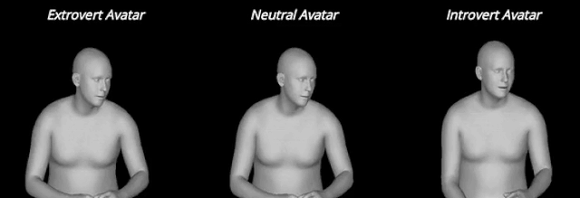
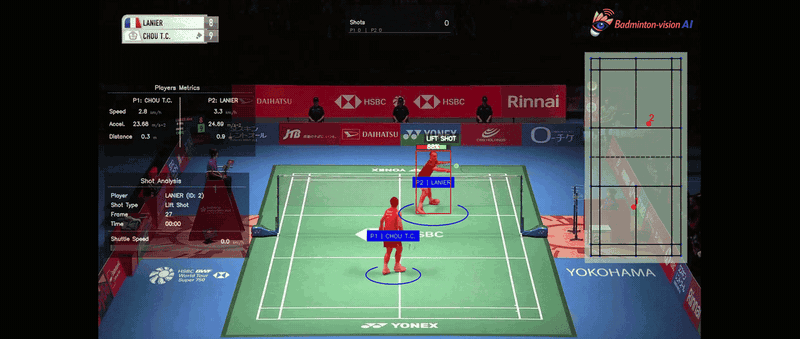
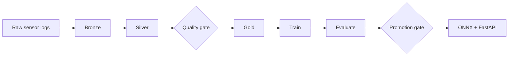
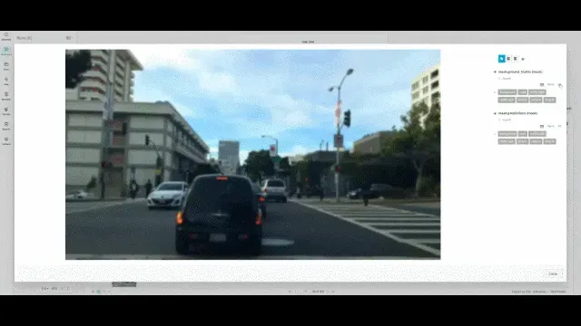
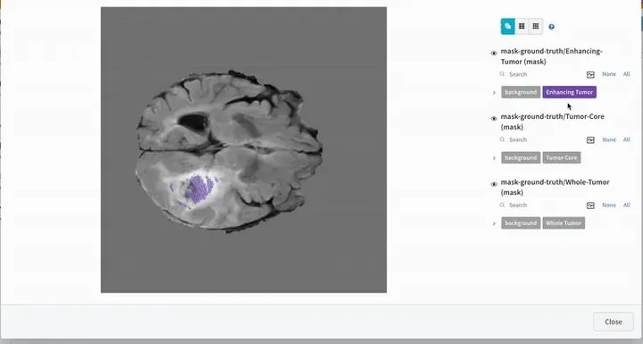
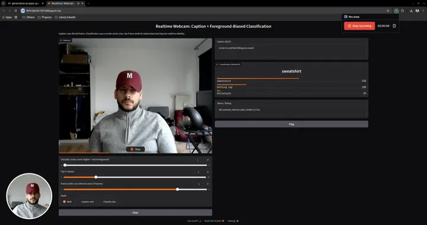
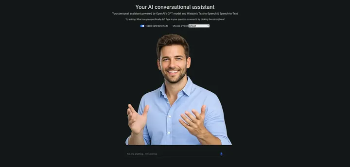

# Amr Amer

**Machine Learning Engineer | Computer Vision | Deep Learning**

M.Sc. Visual Computing, Saarland University · Research engineering experience at DFKI

## About me

I build intelligent visual systems that see, understand and generate, from multimodal 3D avatar generation and real-time sports analytics to medical imaging and autonomous driving perception.

My work lives at the intersection of computer vision, deep learning and generative modeling, with a focus on pushing research-grade systems toward scalable, real-world solutions. On the data and MLOps side, I build reproducible pipelines with DVC, Airflow, Spark and MLflow, add automated data-quality gates, and ship models with Docker, Kubernetes and CI/CD on GitHub Actions.

Currently seeking roles in Machine Learning Engineering and Computer Vision.

## Featured projects

### [Master's thesis: Personality-Aware Non-verbal Behavior Generation](https://github.com/amramer/Personality-Aware-Non-verbal-Behavior-Generation)

A **multimodal generative model** for synthesizing realistic listener avatars in dyadic conversations, conditioned on personality traits. The model predicts facial expressions, head motion and upper-body gestures of a listener from the speaker's audio and motion signals.

  

**Results:** face FID 6.15 and P-FID 10.31, upper-body FID 43.16 and P-FID 87.73, better than a personality-agnostic baseline. In a user study, participants identified the extroverted avatar in 86% of cases.

**Tech stack:** `PyTorch` · `Transformers` · `VQ-VAE` · `SMPL-X (PIXIE)` · `Librosa` · `OpenCV` · `CUDA` · `TensorBoard` · `SLURM` · `Enroot` · `Multi-GPU training (A100)`

[Thesis website](https://amramer.github.io/Personality-Aware-Non-verbal-Behavior-Generation/) | [Repository](https://github.com/amramer/Personality-Aware-Non-verbal-Behavior-Generation) | [Full thesis (PDF)](https://github.com/amramer/Personality-Aware-Non-verbal-Behavior-Generation/blob/main/docs/Thesis_final_doc.pdf)

---

### [Badminton-VisionAI](https://github.com/amramer/Badminton-visionAI)

An **end-to-end computer vision pipeline** for badminton match analysis that converts raw match footage into structured performance analytics for players and coaches. The system tracks players and the shuttlecock, detects shot events, projects motion onto a mini-court representation and generates a downloadable coach-style performance report.

  

**Tech stack:** `Python` · `PyTorch` · `OpenCV` · `YOLO` · `ByteTrack` · `TrackNet` · `SAM` · `Streamlit` · `Plotly` · `Docker` · `CUDA` · `Homography` · `Body pose estimation` · `3D motion trajectories` · `CI/CD pipeline`

[CV pipeline video](https://www.youtube.com/watch?v=dAe9e_1AGuA) | [Dashboard video](https://www.youtube.com/watch?v=Bc2JLifgjzI) | [Repository](https://github.com/amramer/Badminton-visionAI) | [Live demo](https://badminton-visionai-web.onrender.com/) (free server, can take about a minute to wake up)

---

### [AV Sensor DataOps](https://github.com/amramer/av-sensor-dataops)

An **automated pipeline** that turns raw autonomous-vehicle sensor logs (nuScenes camera and LiDAR) into **versioned, quality-checked, ML-ready datasets**, then trains a camera detector, **fuses it with LiDAR for 3D object detection**, evaluates it nuScenes-style and serves it as a **monitored API**.

- **Versioning and lineage:** every stage is a DVC stage; datasets and models are reproducible from a Git tag, and MLflow runs carry the commit and dataset hash
- **Data quality:** Pandera schemas plus sensor and label checks (sync offsets, dropped frames, corrupt files, degraded LiDAR, suspect calibration) that fail the pipeline on errors
- **Orchestration and CI/CD:** Airflow triggers training when a new dataset version lands; GitHub Actions runs tests, the full pipeline on synthetic data and a reproducibility check on every push
- **Serving and monitoring:** ONNX Runtime and FastAPI with Prometheus metrics and Grafana dashboards

**Tech stack:** `DVC` · `Airflow` · `PySpark` · `Pandera` · `MLflow` · `YOLOv8` · `ONNX Runtime` · `FastAPI` · `Prometheus` · `Grafana` · `Docker` · `Kubernetes` · `GitHub Actions`

## More projects

<table>
<tr>
<td width="50%" valign="top">

 <b><a href="https://github.com/amramer/Semantic-Segmentation-Model-for-Autonomous-Vehicles-An-End-to-End-ML-Workflow">Semantic Segmentation for Autonomous Vehicles</a></b>
 Multi-class segmentation of urban street scenes on BDD100K, with systematic hyperparameter sweeps. mIoU ≈ 0.45 (road ≈ 0.88, vehicle ≈ 0.78).
 PyTorch · fastai · Weights &amp; Biases
</td>
<td width="50%" valign="top">

 <b><a href="https://github.com/amramer/brain-tumor-segmentation-3D-DeepLearning">3D Brain Tumor Segmentation (MRI)</a></b>
 Multi-label segmentation of glioma sub-regions from 3D multimodal MRI with a 3D SegResNet. Mean Dice 0.78 (WT 0.90, TC 0.82, ET 0.59).
 PyTorch · MONAI · sliding-window inference · Weights &amp; Biases
</td>
</tr>
<tr>
<td width="50%" valign="top">

 <b><a href="https://github.com/amramer/realtime-vision-captioning">Realtime Vision Captioning</a></b>
 Jupyter notebooks that progress from offline image understanding to a real-time webcam app for live image captioning (BLIP) and classification (ResNet-50).
 PyTorch · Hugging Face Transformers · Gradio
</td>
<td width="50%" valign="top">

 <b>AI Conversational Agent</b> (in progress)
 Real-time voice and text interaction, LLM-powered reasoning and a digital-human interface in a custom web app.
 Python · OpenAI GPT · speech-to-text · text-to-speech · JavaScript
</td>
</tr>
</table>

## Technical skills

| Area | Skills and tools |
|---|---|
| **Computer vision** | Object detection · segmentation · tracking · 3D object detection · camera + LiDAR fusion · video motion analysis · digital human models |
| **Generative AI** | VQ-VAE · diffusion models · VLMs · multimodal generation |
| **Models and frameworks** | PyTorch · TensorFlow · OpenCV · YOLO · SAM · Vision Transformers (ViT) · TrackNet · Supervision |
| **Data pipelines and MLOps** | DVC · Airflow · PySpark · Pandera data-quality checks · MLflow · Weights & Biases · TensorBoard |
| **Deployment** | Docker · Kubernetes · FastAPI · ONNX Runtime · AWS (EC2 GPU) · Streamlit · batch and real-time inference |
| **CI/CD and monitoring** | GitHub Actions · automated testing · Prometheus · Grafana |
| **Compute** | SLURM (HPC) · multi-GPU and multi-node training (CUDA) |
| **Software engineering** | Python · C++ · object-oriented design · Git · unit testing |

For the full overview of my work, visit **[amramer.github.io](https://amramer.github.io/)**.

<em>Building systems that see and understand the world, one model at a time.</em>

